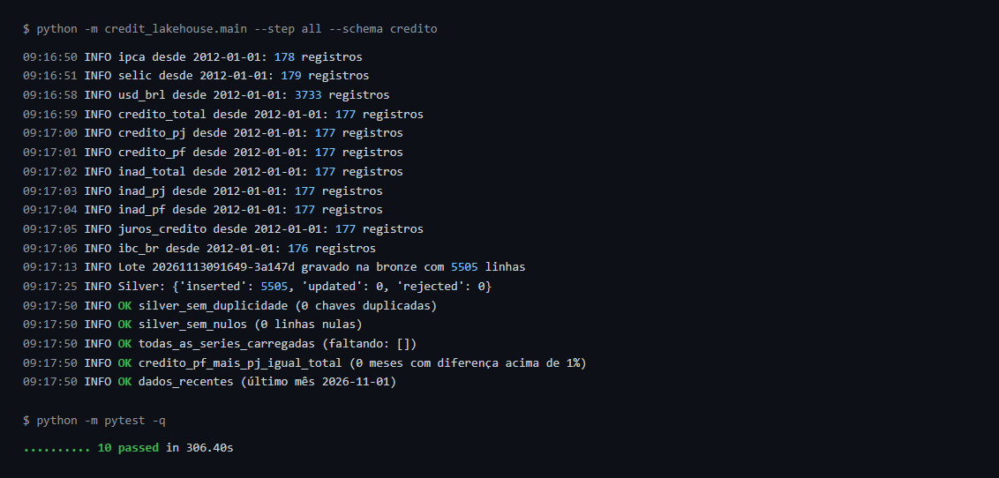

<p align="center"><a href="#english">English</a> · <a href="#portugues">Português</a></p>

<a id="english"></a>

# English

## Credit Lakehouse on Databricks

**A medallion lakehouse (bronze, silver, gold) on Databricks and Delta Lake that loads Brazil's credit and economic indicators from the Central Bank, handles data revisions with MERGE and blocks bad data before it reaches BI.**

The job pulls 11 official series from the Central Bank of Brazil (SGS API): credit portfolio for households and companies, default rates, average lending rate, Selic, IPCA, USD/BRL and IBC-Br. It runs as a Databricks Workflow with four tasks, deployed with **Databricks Asset Bundles**, and is governed with **Unity Catalog**.



### Architecture

```
SGS API ──> bronze_sgs_raw ──> silver_indicator ──> gold_indicator_monthly ──> gold_credit_kpis
            (raw, append-only)   (typed, MERGE)       (monthly)                 (KPIs for BI)
                                      │
                                      └──> silver_quarantine (rejected rows + reason)

quality task ──> ops_quality_log (one row per check per run; critical failures stop the job)
```

| Layer | Table | What it holds |
|---|---|---|
| Bronze | `bronze_sgs_raw` | API response as text, with `batch_id`, `ingested_at` and source. Append-only, never changed |
| Silver | `silver_indicator` | One row per series and date, typed and deduplicated. Change Data Feed on |
| Silver | `silver_series` | Series catalog: code, name, unit, frequency, topic |
| Silver | `silver_quarantine` | Rows that failed the rules: invalid date or value, rate outside 0-100%, non-positive balance |
| Gold | `gold_indicator_monthly` | Every series by month. Daily series become monthly average and end-of-month value |
| Gold | `gold_credit_kpis` | 12-month IPCA, real interest rate, credit growth (total, households, companies), household share, default change in pp, bank spread, IBC-Br growth |
| Ops | `ops_quality_log` | Result of each data quality check |

### Engineering decisions

- **Incremental load with a revision window.** Each run starts from the last date already in silver minus 190 days, because the Central Bank revises recent months. The first run loads everything since 2012.
- **Idempotent MERGE.** Running the same batch twice changes nothing. When the Central Bank revises a value, the row is updated and `revision_count` goes up, so revisions are traceable. Change Data Feed keeps the history of changes.
- **Quarantine instead of failure.** Bad rows go to `silver_quarantine` with the reason, and the good rows keep flowing.
- **Quality gate.** The last task checks for duplicated keys, nulls, missing series and whether households + companies match the total portfolio (within 1%). A critical failure stops the job before BI reads wrong numbers.
- **Performance.** `OPTIMIZE ... ZORDER BY` on silver and gold after each load. Window functions in the gold layer, with no Python loops.
- **Same code locally and on Databricks.** `get_spark()` uses the cluster session on Databricks and creates a local Spark + Delta session elsewhere, so the full pipeline is tested in CI.

### Governance with Unity Catalog

[sql/unity_catalog_governance.sql](sql/unity_catalog_governance.sql) sets up:

- least-privilege grants per group: engineers write, analysts read silver and gold, BI consumers read only gold;
- table and column comments for Catalog Explorer;
- tags per layer, source and PII classification;
- a row filter on the gold table;
- audit and lineage queries on `system.access`.

### Deploy to Databricks

Requires the [Databricks CLI](https://docs.databricks.com/dev-tools/cli/) and a workspace (Databricks Free Edition works).

```sh
databricks auth login
databricks bundle validate
databricks bundle deploy -t dev
databricks bundle run credit_lakehouse -t dev
```

The bundle builds the Python wheel, creates the job with serverless compute and schedules it for the 6th and 21st of each month. The `dev` target writes to `workspace.credito_dev`; `prod` writes to `workspace.credito`. Change the catalog with `--var catalog=<name>`.

### Run and test locally

Requires **Python 3.11+** and **Java 17+**:

```sh
pip install -e ".[dev]"
python -m pytest -v
python -m credit_lakehouse.main --step all --schema credito
```

Without Java, use Docker:

```sh
docker build -f Dockerfile.test -t lakehouse-tests .
docker run --rm lakehouse-tests
```

Expected result: **10 tests passed**. The tests use a fake API and cover deduplication, quarantine, idempotent reprocessing, value revisions, incremental watermark, daily-to-monthly aggregation, gold KPIs and the quality gate.

A full run against the live API loads **5,505 rows** for the 11 series (2012 to today), and all quality checks pass, including households + companies matching the total portfolio in every month.

### Project structure

```
databricks.yml                    Asset Bundle: artifacts, variables, dev/prod targets
resources/credit_lakehouse.job.yml  Job with 4 tasks: bronze → silver → gold → quality
src/credit_lakehouse/
  config.py     Series catalog and table names
  bronze.py     API ingestion with retries and watermark
  silver.py     Parsing, quality rules, quarantine and MERGE
  gold.py       Monthly table, KPIs with window functions, OPTIMIZE
  quality.py    Quality checks and log
  main.py       Entry point used by the job
sql/unity_catalog_governance.sql  Grants, comments, tags, row filter, audit and lineage
tests/                            pytest with local Spark and Delta Lake
```

### Technologies

Databricks, Delta Lake, Apache Spark, PySpark, Unity Catalog, Databricks Asset Bundles, Databricks Workflows, serverless compute, medallion architecture, lakehouse, MERGE / upsert, Change Data Feed, data quality, data governance, Python, SQL, pytest, GitHub Actions (CI), Docker.

---

<a id="portugues"></a>

# Português

## Lakehouse de Crédito no Databricks

**Um lakehouse em camadas (bronze, silver, gold) no Databricks e Delta Lake que carrega indicadores de crédito e economia do Banco Central, trata revisões de dados com MERGE e barra dados ruins antes de chegarem ao BI.**

O job busca 11 séries oficiais do Banco Central (API do SGS): saldo de crédito de pessoas físicas e jurídicas, inadimplência, taxa média de juros, Selic, IPCA, dólar e IBC-Br. Ele roda como um Workflow do Databricks com quatro tarefas, publicado com **Databricks Asset Bundles**, e é governado com **Unity Catalog**.


### Camadas

| Camada | Tabela | O que guarda |
|---|---|---|
| Bronze | `bronze_sgs_raw` | Resposta da API em texto, com `batch_id`, `ingested_at` e origem. Só recebe inserções |
| Silver | `silver_indicator` | Uma linha por série e data, tipada e sem duplicidade. Change Data Feed ativado |
| Silver | `silver_series` | Catálogo das séries: código, nome, unidade, frequência e tema |
| Silver | `silver_quarantine` | Linhas reprovadas: data ou valor inválido, taxa fora de 0-100%, saldo não positivo |
| Gold | `gold_indicator_monthly` | Todas as séries por mês. Séries diárias viram média e valor de fim de mês |
| Gold | `gold_credit_kpis` | IPCA 12 meses, juro real, crescimento do crédito, participação de PF, variação da inadimplência, spread e IBC-Br |
| Ops | `ops_quality_log` | Resultado de cada checagem de qualidade |

### Decisões de engenharia

- **Carga incremental com janela de revisão.** Cada execução parte da última data da silver menos 190 dias, porque o Banco Central revisa os meses recentes. A primeira carga traz tudo desde 2012.
- **MERGE idempotente.** Rodar o mesmo lote duas vezes não muda nada. Quando o Banco Central revisa um valor, a linha é atualizada e o `revision_count` aumenta, deixando a revisão rastreável. O Change Data Feed guarda o histórico das mudanças.
- **Quarentena em vez de falha.** Linhas ruins vão para a `silver_quarantine` com o motivo, e as boas seguem o fluxo.
- **Portão de qualidade.** A última tarefa verifica chaves duplicadas, nulos, séries faltando e se PF + PJ batem com o total (até 1% de diferença). Uma falha crítica para o job antes de o BI ler números errados.
- **Performance.** `OPTIMIZE ... ZORDER BY` na silver e na gold a cada carga. Funções de janela na gold, sem laços em Python.
- **Mesmo código local e no Databricks.** `get_spark()` usa a sessão do cluster no Databricks e cria uma sessão local com Spark e Delta fora dele, então o pipeline inteiro é testado no CI.

### Governança com Unity Catalog

O arquivo [sql/unity_catalog_governance.sql](sql/unity_catalog_governance.sql) configura:

- permissões por grupo com menor privilégio: engenharia escreve, analistas leem silver e gold, consumidores de BI leem só a gold;
- comentários de tabelas e colunas;
- tags de camada, origem e classificação de dados pessoais;
- filtro de linha na gold;
- consultas de auditoria e linhagem em `system.access`.

### Publicar no Databricks

Requer a [Databricks CLI](https://docs.databricks.com/dev-tools/cli/) e um workspace (o Databricks Free Edition funciona).

```sh
databricks auth login
databricks bundle validate
databricks bundle deploy -t dev
databricks bundle run credit_lakehouse -t dev
```

O bundle gera o wheel do Python, cria o job com computação serverless e agenda para os dias 6 e 21 de cada mês.

### Executar e testar localmente

Requer **Python 3.11+** e **Java 17+**:

```sh
pip install -e ".[dev]"
python -m pytest -v
python -m credit_lakehouse.main --step all --schema credito
```

Sem Java, use o Docker:

```sh
docker build -f Dockerfile.test -t lakehouse-tests .
docker run --rm lakehouse-tests
```

Resultado esperado: **10 testes aprovados**. Os testes usam uma API simulada e cobrem deduplicação, quarentena, reprocessamento idempotente, revisão de valores, carga incremental, agregação de diário para mensal, indicadores da gold e o portão de qualidade.

Uma execução completa com a API real carrega **5.505 linhas** das 11 séries (de 2012 até hoje), e todas as checagens de qualidade passam, inclusive PF + PJ batendo com o total em todos os meses.

### Tecnologias

Databricks, Delta Lake, Apache Spark, PySpark, Unity Catalog, Databricks Asset Bundles, Databricks Workflows, computação serverless, arquitetura medalhão, lakehouse, MERGE / upsert, Change Data Feed, qualidade de dados, governança de dados, Python, SQL, pytest, GitHub Actions (CI), Docker.
